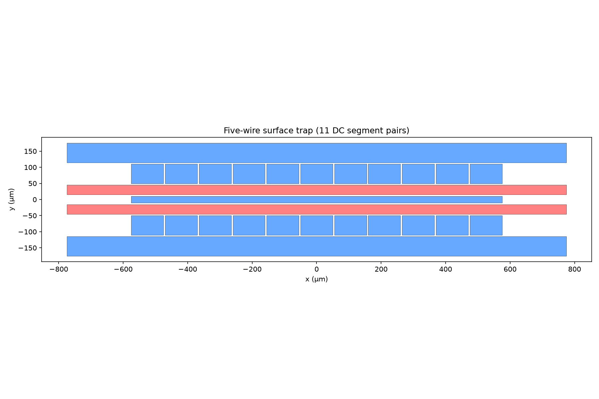

# IontrapdesignBot

**AI-agent-driven ion-trap layout design over MCP — from a natural-language specification to parameterized electrodes, electrostatic analysis, optimization, and GDS.**

[English](README.md) · [简体中文](README.zh-CN.md)

[](LICENSE)
[](pyproject.toml)
[](https://modelcontextprotocol.io/)

> **Inspired by [KlayoutClaw](https://github.com/caidish/KlayoutClaw), created by [@caidish](https://github.com/caidish).**
>
> KlayoutClaw's approach to AI-assisted layout design—connecting coding agents to layout tools through the Model Context Protocol (MCP) and reusable agent skills—was the primary architectural inspiration for IontrapdesignBot. This project adapts those ideas to the ion-trap domain with parameterized trap geometries, a BEM electrostatics engine, geometry optimization, and a standalone [gdstk](https://github.com/heitzmann/gdstk) backend. See [Acknowledgements](#acknowledgements) for details.

IontrapdesignBot lets Claude Code or another MCP-compatible agent generate and inspect surface ion-trap layouts, evaluate RF pseudopotentials and trapping characteristics, solve DC control voltages, check electrode spacing, and export GDS—without requiring the KLayout GUI.

> **Project naming:** the GitHub repository and project are named **IontrapdesignBot**. The installable Python distribution, import package (`iontrap_mcp`), and command-line executable (`iontrapclaw`) retain their existing names.

## Example



*A parameterized five-wire surface trap generated by IontrapdesignBot. Blue: DC electrodes; red: RF rails.*

## Highlights

- **Parameterized trap geometries** — five-wire linear traps, X/T junctions, racetrack traps with optimizable bends, and an experimental two-layer placeholder.
- **Agent-native workflow** — MCP tools plus four Claude Code skills for surface traps, junctions, field evaluation, and end-to-end design.
- **Electrostatic analysis** — first-kind boundary element method (BEM), RF-null search, pseudopotential and trap-depth estimates, secular frequencies, and DC voltage synthesis.
- **Closed-loop geometry optimization** — Nelder–Mead optimization for target null heights, multi-region null uniformity, pseudopotential barriers, and minimum-gap constraints.
- **Layout inspection and export** — PNG rendering, minimum-spacing DRC, DC fanout and bonding pads, GDSII, and name-preserving JSON.
- **Standalone and cross-platform** — geometry and GDS I/O use gdstk; KLayout is optional as a GDS viewer, not a runtime dependency.

## How it works

```text
Natural-language design goal
            │
            ▼
┌─────────────────────────┐
│ Claude Code / MCP agent │
│    + ion-trap skills    │
└────────────┬────────────┘
             │ MCP (stdio or streamable HTTP)
             ▼
┌──────────────────────────────────────────────┐
│             IontrapdesignBot server          │
│                                              │
│  Electrode generators   Layout + DRC + GDS   │
│  BEM electrostatics     DC voltage solver    │
│  Trap characterization  Geometry optimizer   │
│                                              │
│       gdstk · NumPy · SciPy · Shapely        │
└──────────────────────────────────────────────┘
             │
             ▼
 PNG inspection · trap metrics · DC voltages · GDS / JSON
```

A typical agent workflow is:

1. Parse the specification and state assumptions.
2. Generate a parameterized layout and render it for visual inspection.
3. Run spacing checks and BEM-based trap characterization.
4. Iterate or optimize geometry against the requested targets.
5. Solve DC voltages, add fanout, and export GDS plus JSON.

## Quick start

### Requirements

- Python **3.10 or newer**; Python 3.11 is recommended.
- An MCP-compatible client. The commands below use [Claude Code](https://docs.anthropic.com/en/docs/claude-code/overview) as an example.
- No KLayout installation is required.

### Install from source

```bash
git clone https://github.com/zipeilee/IontrapdesignBot.git
cd IontrapdesignBot
python3.11 -m venv .venv
source .venv/bin/activate
python -m pip install --upgrade pip
python -m pip install -e ".[dev]"
```

On Windows, activate the environment with `.venv\Scripts\activate` instead of the `source` command.

### Connect to Claude Code over stdio

From the repository root:

```bash
claude mcp add iontrapclaw -- "$PWD/.venv/bin/iontrapclaw"
```

The `iontrapclaw` executable starts an MCP stdio server by default. For other MCP clients, configure the same executable as a local stdio server.

### Install the agent skills

The skills provide design procedures and numerical-validation guidance in addition to raw tool access. Skills, examples, and documentation are **source-repository assets**: use the GitHub checkout for these resources; the standalone Python wheel currently installs only the `iontrap_mcp` package and `iontrapclaw` CLI.

```bash
mkdir -p ~/.claude/skills
cp -R skills/iontrap-* ~/.claude/skills/
```

Restart or reload the client if it does not discover newly installed skills automatically.

### Optional: streamable HTTP

```bash
# Terminal 1
source .venv/bin/activate
iontrapclaw --transport http --host 127.0.0.1 --port 8765

# Terminal 2
claude mcp add --transport http iontrapclaw http://127.0.0.1:8765/mcp
```

Keep the server bound to `127.0.0.1` unless you have added appropriate authentication and network controls. See [Security notes](#security-notes).

### Ask the agent to design a trap

> Design a segmented-DC five-wire surface trap for ¹⁷¹Yb⁺ with 11 DC segment pairs. Target an ion height near 50 µm, use 100 V zero-to-peak RF at 30 MHz, inspect the layout, check a 3 µm minimum gap, characterize the trap, and export both GDS and JSON.

The agent can use the tools below directly; the installed skills help it choose a robust design-and-validation sequence.

## MCP tools

| Tool | Purpose |
|---|---|
| `new_layout` / `list_layouts` / `close_layout` | Create, inspect, and close in-memory layout sessions. |
| `list_electrodes` | List electrode names, kinds, GDS layers, and polygon counts. |
| `generate_trap` | Generate `five_wire`, `x_junction`, `t_junction`, `two_layer`, or `racetrack` geometry. Replaces the current layout contents. |
| `add_fanout` | Route DC electrodes to tapered traces and bonding pads. |
| `render_layout` | Return a rendered PNG for agent visual inspection. |
| `evaluate_trap` | Run BEM analysis and return trap position, depth, secular frequencies, and RF-null height. |
| `optimize_trap` | Optimize geometry for null-height targets, regional uniformity, pseudopotential barriers, and minimum-gap constraints. |
| `solve_dc_voltages` | Least-squares DC voltage synthesis for field-null and potential targets. |
| `drc_check` | Check minimum spacing between electrode pairs. |
| `save_gds` / `open_gds` | Export and import GDSII (1 µm unit, 1 nm precision). |
| `save_layout_json` / `open_layout_json` | Save and restore geometry while preserving electrode names, kinds, polygons, and metadata. |
| `execute_script` | Escape hatch for custom Python operations on the current `ElectrodeSet`. **Executes arbitrary code; see below.** |

See [docs/tools.md](docs/tools.md) for parameters and return values. Each MCP tool also exposes a docstring with its current interface and usage notes.

## Use as a Python library

The geometry and analysis modules can also be used without an MCP client:

```python
from iontrap_mcp.electrodes import five_wire
from iontrap_mcp.render import render

trap = five_wire(
    n_dc_segments=11,
    dc_gap=5.0,
    rf_width=30.0,
    rf_gap=5.0,
    center_width=20.0,
)

output = render(
    trap,
    "five_wire.png",
    labels=False,
    title="Five-wire surface trap",
)
print(f"Generated {len(trap.electrodes)} electrodes: {output}")
```

Additional reproducible geometry, optimization, benchmark, and report-building scripts are in [`examples/`](examples/). The pre-generated five-wire example is available as [PNG](examples/demo_fivewire.png), [JSON](examples/demo_fivewire.json), and [GDS](examples/demo_fivewire.gds).

## Physical model and units

- Electrode coordinates and dimensions are in **micrometres (µm)**; electrodes lie in the `z = 0` plane and the ion occupies the `z > 0` half-space.
- The electrostatic solver uses a **first-kind boundary element method**: electrodes are discretized into square panels, surface charge densities are obtained by point-collocation, and potentials/fields are evaluated by analytic panel sums.
- RF confinement is estimated using the pseudopotential approximation

  $$\Psi = \frac{Q^2 |E_{\mathrm{RF}}|^2}{4m\Omega^2},$$

  where `Q` is ion charge, `m` is ion mass, and `Ω` is RF angular frequency.
- Secular frequencies are obtained from a numerical Hessian of the total effective potential. Trap depth, position, and RF-null height are returned by `evaluate_trap`.
- Defaults are **¹⁷¹Yb⁺**, **100 V zero-to-peak RF**, and **30 MHz**; these can be overridden through tool parameters.
- `max_panel_size` controls BEM accuracy and cost. Use convergence checks for important results and keep panels fine enough to resolve the smallest electrode gaps.

## Current limitations

IontrapdesignBot is a research and design-aid tool, not a fabrication sign-off or full-wave simulation package.

- The current physical model is for planar surface-electrode traps. `two_layer` is an experimental geometry placeholder, not a validated multilayer electromagnetic model.
- The BEM implementation uses dense matrices; whole-chip models can become memory-intensive. Divide large layouts into appropriate regions.
- Ion transport dynamics, anomalous heating, RF losses, substrate effects, and fabrication tolerances are not comprehensively modeled.
- DRC here means electrode-spacing checks, not a foundry-certified design-rule deck.
- Validate critical designs with mesh-convergence studies, independent field solvers where appropriate, and the target fabrication process rules.

## Security notes

- `execute_script` intentionally runs arbitrary Python with the same permissions as the server process. It is **not sandboxed**. Enable it only for trusted agents and layouts.
- File I/O tools can read or write paths accessible to the server process. Run the server with least privilege.
- The HTTP transport has no project-specific authentication layer in this repository. Keep it on localhost and do not expose it directly to an untrusted network.

## Development

```bash
source .venv/bin/activate
python -m pytest tests/ -q
```

Project layout:

```text
iontrap_mcp/
  electrodes/       Parameterized surface, junction, racetrack, and routing geometry
  fields/           BEM solver, trap characterization, and DC voltage synthesis
  optimize.py       Geometry optimization
  server.py         MCP tools and stdio/HTTP entry point
  session.py        Layout sessions and GDS/JSON I/O
skills/             Four Claude Code ion-trap design skills
examples/           Example layouts, scripts, numerical results, and reports
tests/              Unit, regression, analytical, and MCP end-to-end tests
docs/               Tool reference
```

Contributions are welcome; please read [CONTRIBUTING.md](CONTRIBUTING.md).

## Acknowledgements

### Primary design inspiration

**[KlayoutClaw](https://github.com/caidish/KlayoutClaw) by [@caidish](https://github.com/caidish)** is the primary architectural inspiration for IontrapdesignBot. In particular, KlayoutClaw demonstrated a powerful way to combine **MCP-accessible layout tools, coding agents, and reusable agent skills** for AI-assisted layout design.

IontrapdesignBot adapts that approach to ion-trap research: the layout backend uses **gdstk rather than requiring KLayout**, and the domain-specific electrode generators, BEM electrostatic analysis, trap characterization, DC voltage solver, and geometry optimizer are built around surface ion-trap design workflows. We are grateful to the KlayoutClaw authors and contributors for making their work available as open source.

### Open-source foundations

IontrapdesignBot also builds on:

- [Model Context Protocol](https://modelcontextprotocol.io/) and its [Python SDK](https://github.com/modelcontextprotocol/python-sdk) for agent-tool interoperability.
- [gdstk](https://github.com/heitzmann/gdstk) for GDSII geometry and file I/O.
- [NumPy](https://numpy.org/) and [SciPy](https://scipy.org/) for numerical linear algebra, analysis, and optimization.
- [Shapely](https://github.com/shapely/shapely) for planar geometry operations.
- [Matplotlib](https://matplotlib.org/) for layout visualization.
- [Claude Code](https://docs.anthropic.com/en/docs/claude-code/overview) and the broader MCP client ecosystem for agent-driven workflows.

## License

IontrapdesignBot is released under the [MIT License](LICENSE). Third-party projects retain their own licenses; the acknowledgement above identifies inspiration and dependencies without changing their license terms.
