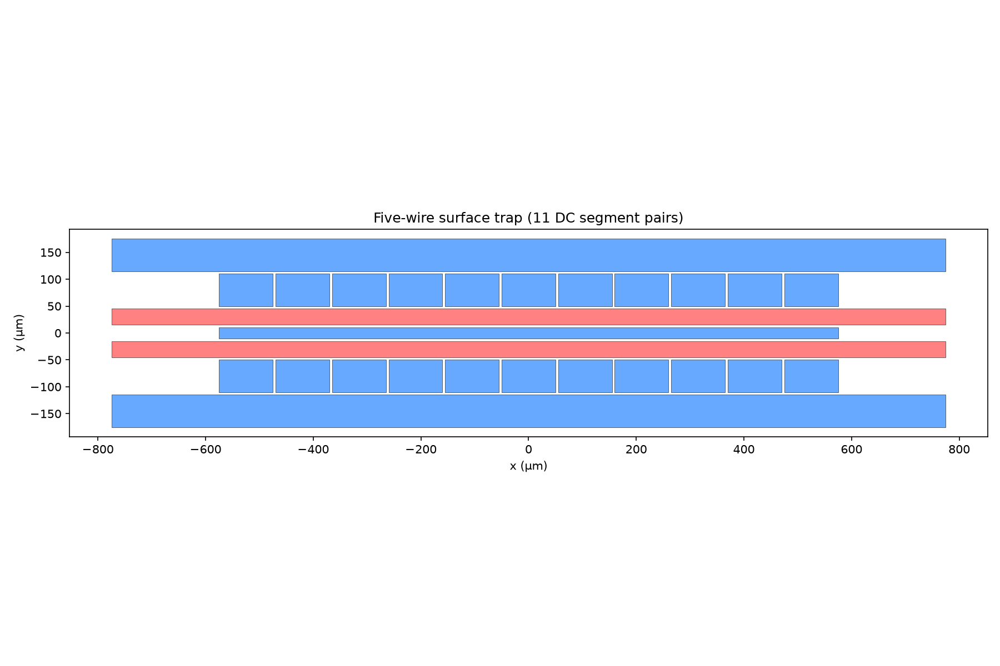

# IontrapdesignBot

**通过 MCP 让 AI agent 完成离子阱版图设计：从自然语言指标到参数化电极、静电场分析、几何优化和 GDS 输出。**

[English](README.md) · [简体中文](README.zh-CN.md)

[](LICENSE)
[](pyproject.toml)
[](https://modelcontextprotocol.io/)

> **Inspired by [KlayoutClaw](https://github.com/caidish/KlayoutClaw)，原作者为 [@caidish](https://github.com/caidish)。**
>
> KlayoutClaw 将 Model Context Protocol（MCP）、coding agent、可复用 agent skills 与版图工具结合的方式，是 IontrapdesignBot 最主要的架构灵感来源。本项目将这一思路用于离子阱设计，加入参数化阱电极、BEM 静电场求解、阱特性分析、几何优化和独立的 [gdstk](https://github.com/heitzmann/gdstk) 版图后端。详细说明见[致谢](#致谢)。

IontrapdesignBot 让 Claude Code 或其他 MCP 兼容 agent 生成并检查表面离子阱版图，评估 RF 赝势和囚禁特性，反解 DC 控制电压，检查电极间距并导出 GDS；运行时不需要 KLayout GUI。

> **名称说明：**GitHub 仓库和项目名为 **IontrapdesignBot**；Python 发行包、导入包 `iontrap_mcp` 和命令行程序 `iontrapclaw` 暂时保留原名称。

## 示例



*由 IontrapdesignBot 参数化生成的五线表面阱。蓝色为 DC 电极，红色为 RF 电极。*

## 主要功能

- **参数化电极几何**：五线线性阱、X/T junction、可优化弯道的跑道阱，以及实验性的双层几何占位实现。
- **面向 agent 的工作流**：MCP 工具配合四个 Claude Code skills，覆盖表面阱、junction、场评估和端到端设计。
- **静电场与囚禁特性分析**：第一类边界元法（BEM）、RF null 搜索、赝势与阱深估算、secular 频率和 DC 电压反解。
- **闭环几何优化**：使用 Nelder–Mead 优化目标 null 高度、多区域 null 一致性、赝势势垒，并支持最小间隙约束。
- **版图检查与输出**：PNG 渲染、最小间距 DRC、DC 扇出与 bonding pad、GDSII，以及保留电极命名的 JSON。
- **独立、跨平台**：几何和 GDS I/O 基于 gdstk；KLayout 只作为可选 GDS 查看器，不是运行依赖。

## 工作流程

```text
自然语言设计指标
        │
        ▼
┌─────────────────────────┐
│ Claude Code / MCP agent │
│    + ion-trap skills    │
└────────────┬────────────┘
             │ MCP（stdio 或 streamable HTTP）
             ▼
┌──────────────────────────────────────────────┐
│             IontrapdesignBot server          │
│                                              │
│  参数化电极生成器       版图 / DRC / GDS       │
│  BEM 静电场求解         DC 电压反解            │
│  阱特性分析             几何优化器             │
│                                              │
│       gdstk · NumPy · SciPy · Shapely        │
└──────────────────────────────────────────────┘
             │
             ▼
 PNG 检查图 · 囚禁指标 · DC 电压 · GDS / JSON
```

典型设计闭环：解析指标并说明假设 → 生成与渲染几何 → DRC 和 BEM 分析 → 迭代或自动优化 → 反解 DC 电压、扇出并导出 GDS/JSON。

## 快速开始

### 环境要求

- Python **3.10 或更新版本**，推荐 Python 3.11。
- MCP 兼容客户端；以下命令以 [Claude Code](https://docs.anthropic.com/en/docs/claude-code/overview) 为例。
- 不需要安装 KLayout。

### 从源码安装

```bash
git clone https://github.com/zipeilee/IontrapdesignBot.git
cd IontrapdesignBot
python3.11 -m venv .venv
source .venv/bin/activate
python -m pip install --upgrade pip
python -m pip install -e ".[dev]"
```

Windows 下请用 `.venv\Scripts\activate` 替代 `source` 命令。

### 通过 stdio 接入 Claude Code

在仓库根目录执行：

```bash
claude mcp add iontrapclaw -- "$PWD/.venv/bin/iontrapclaw"
```

`iontrapclaw` 默认启动 MCP stdio server。其他 MCP 客户端可将同一个可执行文件配置为本地 stdio server。

### 安装 agent skills

skills 不仅提供工具调用说明，还包含设计流程和数值验证建议。skills、examples 和文档属于 **GitHub 源码仓库资产**：请通过源码 checkout 使用这些资源；单独的 Python wheel 目前只安装 `iontrap_mcp` 包和 `iontrapclaw` 命令行程序。

```bash
mkdir -p ~/.claude/skills
cp -R skills/iontrap-* ~/.claude/skills/
```

如果客户端没有自动发现新 skills，请重启或重新加载客户端。

### 可选：streamable HTTP

```bash
# 终端 1
source .venv/bin/activate
iontrapclaw --transport http --host 127.0.0.1 --port 8765

# 终端 2
claude mcp add --transport http iontrapclaw http://127.0.0.1:8765/mcp
```

除非已经配置合适的认证和网络访问控制，否则请保持监听 `127.0.0.1`。详见[安全说明](#安全说明)。

### 用自然语言发起设计

> 帮我设计一个用于 ¹⁷¹Yb⁺ 的分段 DC 五线表面阱：11 对 DC 分段，目标离子高度约 50 µm，RF 为 100 V 零峰值、30 MHz。先渲染检查版图，再检查 3 µm 最小间隙、评估囚禁特性，最后导出 GDS 和 JSON。

agent 可以直接调用下表工具；安装的 skills 会帮助它采用更可靠的设计与验证顺序。

## MCP 工具

| 工具 | 作用 |
|---|---|
| `new_layout` / `list_layouts` / `close_layout` | 创建、查看和关闭内存中的版图会话。 |
| `list_electrodes` | 列出电极名称、类型、GDS layer 和多边形数量。 |
| `generate_trap` | 生成 `five_wire`、`x_junction`、`t_junction`、`two_layer` 或 `racetrack`；会替换当前版图内容。 |
| `add_fanout` | 为 DC 电极生成锥形扇出引线和 bonding pad。 |
| `render_layout` | 返回 PNG，供 agent 进行视觉检查。 |
| `evaluate_trap` | BEM 求解并返回阱位置、阱深、secular 频率和 RF null 高度。 |
| `optimize_trap` | 针对 null 高度、多区域一致性、路径赝势峰和最小间隙约束优化几何。 |
| `solve_dc_voltages` | 用最小二乘法反解满足 field-null / potential 目标的 DC 电压。 |
| `drc_check` | 检查所有电极对的最小间距。 |
| `save_gds` / `open_gds` | 导入导出 GDSII（单位 1 µm，精度 1 nm）。 |
| `save_layout_json` / `open_layout_json` | 保存和恢复几何，保留电极名称、类型、多边形和元数据。 |
| `execute_script` | 对当前 `ElectrodeSet` 执行自定义 Python。**可执行任意代码，见安全说明。** |

参数和返回值详见 [docs/tools.md](docs/tools.md)；各 MCP 工具自带的 docstring 也包含当前接口和使用注意事项。

## 作为 Python 库使用

不经过 MCP 客户端也可以直接使用几何和分析模块：

```python
from iontrap_mcp.electrodes import five_wire
from iontrap_mcp.render import render

trap = five_wire(
    n_dc_segments=11,
    dc_gap=5.0,
    rf_width=30.0,
    rf_gap=5.0,
    center_width=20.0,
)

output = render(
    trap,
    "five_wire.png",
    labels=False,
    title="Five-wire surface trap",
)
print(f"生成了 {len(trap.electrodes)} 个电极：{output}")
```

[`examples/`](examples/) 中包含可复现的几何、优化、基准测试和报告构建脚本。预生成的五线阱示例提供 [PNG](examples/demo_fivewire.png)、[JSON](examples/demo_fivewire.json) 和 [GDS](examples/demo_fivewire.gds)。

## 物理模型与单位

- 电极坐标和几何尺寸使用 **微米（µm）**；电极位于 `z = 0` 平面，离子位于 `z > 0` 半空间。
- 静电场使用**第一类边界元法**：将电极剖分为方形面板，以点电荷配点法求面电荷密度，再通过解析面板求和计算电势和电场。
- RF 囚禁采用赝势近似：

  $$\Psi = \frac{Q^2 |E_{\mathrm{RF}}|^2}{4m\Omega^2},$$

  其中 `Q` 为离子电荷、`m` 为离子质量、`Ω` 为 RF 角频率。
- secular 频率由总有效势的数值 Hessian 求得；`evaluate_trap` 同时返回阱深、位置和 RF null 高度。
- 默认参数为 **¹⁷¹Yb⁺**、**100 V 零峰值 RF**、**30 MHz**，均可通过工具参数覆盖。
- `max_panel_size` 控制 BEM 精度和计算成本。重要结果必须做面板加密收敛性检查，面板尺寸应足以解析最小电极间隙。

## 当前限制

IontrapdesignBot 是研究和设计辅助工具，不能替代流片 sign-off 或全波电磁仿真。

- 当前物理模型面向平面表面电极阱；`two_layer` 是实验性几何占位实现，不是经过验证的多层电磁模型。
- BEM 使用稠密矩阵，整芯片模型可能消耗大量内存；大型设计应分区域求解。
- 离子输运动力学、反常加热、RF 损耗、衬底效应和工艺误差未被完整建模。
- 这里的 DRC 是电极间距检查，不是 foundry 认证的完整设计规则套件。
- 关键设计应进行网格收敛性验证，必要时使用独立场求解器交叉验证，并遵循目标工艺规则。

## 安全说明

- `execute_script` 会以 server 进程的权限执行任意 Python，**没有沙箱隔离**。只应让受信任的 agent 和任务使用。
- 文件 I/O 工具可读写 server 进程有权限访问的路径，请以最小权限运行 server。
- 本仓库没有为 HTTP transport 增加项目级认证层。请保持 localhost 监听，不要直接暴露到不可信网络。

## 开发与测试

```bash
source .venv/bin/activate
python -m pytest tests/ -q
```

```text
iontrap_mcp/
  electrodes/       表面阱、junction、跑道和扇出的参数化几何
  fields/           BEM、阱特性分析和 DC 电压反解
  optimize.py       几何优化
  server.py         MCP 工具及 stdio/HTTP 入口
  session.py        版图会话和 GDS/JSON I/O
skills/             四个 Claude Code 离子阱设计 skills
examples/           示例版图、脚本、数值结果和报告
tests/              单元、回归、解析基准和 MCP 端到端测试
docs/               工具参考
```

欢迎贡献代码、几何生成器、解析基准和文档；请先阅读 [CONTRIBUTING.md](CONTRIBUTING.md)。

## 致谢

### 主要架构灵感

**[KlayoutClaw](https://github.com/caidish/KlayoutClaw)，由 [@caidish](https://github.com/caidish) 创建，是 IontrapdesignBot 最主要的架构灵感来源。** 尤其是 KlayoutClaw 将 **MCP 可调用的版图工具、coding agent 和可复用 agent skills** 结合起来进行 AI 辅助版图设计的思路，直接启发了本项目的架构。

IontrapdesignBot 将这一方法用于离子阱研究：版图后端采用 **gdstk，不依赖 KLayout GUI**；面向表面离子阱的参数化电极生成、BEM 静电场分析、阱特性表征、DC 电压反解和几何优化均围绕本领域工作流实现。感谢 KlayoutClaw 的作者和贡献者将他们的工作开源。

### 开源基础项目

本项目还依赖或受益于：

- [Model Context Protocol](https://modelcontextprotocol.io/) 及其 [Python SDK](https://github.com/modelcontextprotocol/python-sdk)：agent 与工具互操作。
- [gdstk](https://github.com/heitzmann/gdstk)：GDSII 几何和文件 I/O。
- [NumPy](https://numpy.org/) 与 [SciPy](https://scipy.org/)：数值线性代数、分析和优化。
- [Shapely](https://github.com/shapely/shapely)：平面几何操作。
- [Matplotlib](https://matplotlib.org/)：版图可视化。
- [Claude Code](https://docs.anthropic.com/en/docs/claude-code/overview) 和 MCP 客户端生态：agent 驱动的工作流。

## License

IontrapdesignBot 使用 [MIT License](LICENSE) 开源。第三方项目保留各自许可证；上述致谢用于明确说明架构灵感和依赖关系，不改变其许可证条款。
